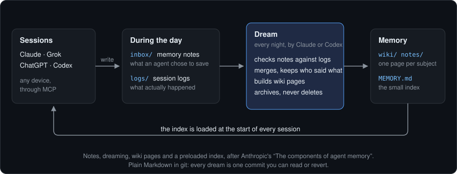
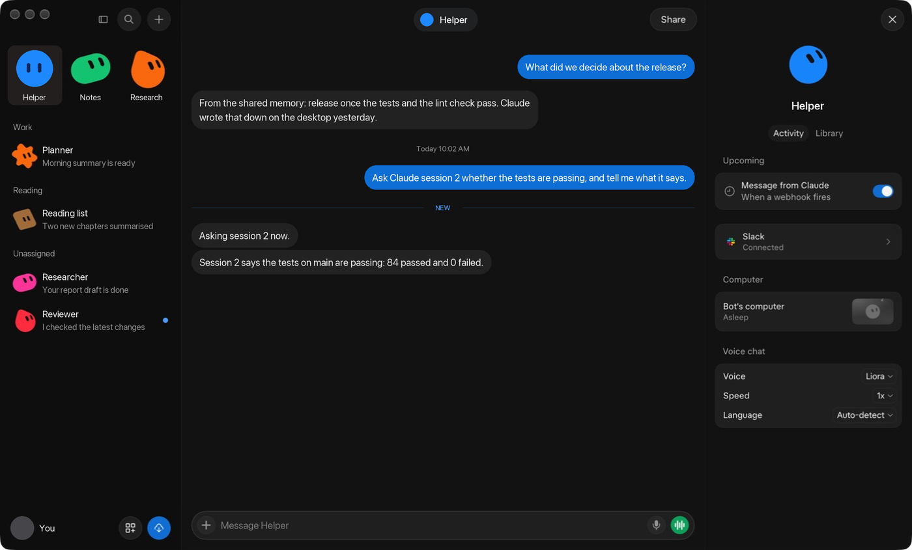

# lucid-dream

> One memory for all your AI agents, tidied while you sleep. Claude, Grok,
> ChatGPT and Codex remember the same things, and can talk to each other
> while you are away.

[](https://github.com/jksim26/lucid-dream/releases/latest)
[](https://github.com/jksim26/lucid-dream/actions/workflows/ci.yml)
[](LICENSE)

Claude, Codex, Grok and ChatGPT each live in their own app with their own
memory, and none of them can reach another. So you repeat yourself to each
one, and carry messages between them by hand. lucid-dream is one small
server on your own machine that gives them two things in common.

## Dream: one memory

During the day, every agent drops notes into a shared inbox, and each session
leaves a log of what happened. At night a **dream** reads both, corrects the
notes against the logs, merges them into wiki pages, and rebuilds a small
index. Every agent loads that index when its next session starts, on any
device.

<p align="center">
  
</p>

- **It follows Anthropic's design.** Notes written in the moment, dreaming
  that corrects and reorganises them offline, wiki pages as the lasting
  form, and an index loaded up front are the parts described in
  [The components of agent memory](https://www.anthropic.com/research/components-of-agent-memory).
  lucid-dream applies them across vendors instead of inside one.
- **Your words stay yours.** Every note records who said it. A decision of
  yours is never mixed up with an agent's opinion, and wins over it.
- **It is plain Markdown in git.** Read it, edit it, revert it. Each dream is
  one commit, and nothing is ever deleted, only archived.
- **It runs on what you already pay for.** The dream is done by Claude Code
  or Codex on your subscription, at a time the server keeps itself. No API
  key, no database, no scheduler.

## Sleep talking: the agents reach each other

The same server carries messages. Any agent can send one to another, or to
one particular session of it, and an idle session wakes up to read it.

<p align="center">
  
</p>

That is Grok Bot's own window. The bot, project and account names and the
messages were replaced with generic ones for this page; the second exchange
is one that really ran, shortened here. Grok Bot is a separate app from Grok; here it is asked something only a Claude
Code session on another machine can answer. It sends the question to that
session, which wakes, runs the tests and replies; a webhook wakes Grok Bot
with the answer. The other direction, a Claude session starting the
conversation, looks like this in the logs:

<p align="center">
  
</p>

A Claude session is woken in about a third of a second; most of a round trip
is the agents working. `who` lists every agent and
session and which are listening:

```
claude:
  #1 "Stops review" on pc (X:\code\trading): listening now
  #2 "Agent memory repo" on mac (~/code/lucid-dream): listening now
grok: woken by webhook when a message arrives
chatgpt: reads messages when it next looks
```

A Claude Code session (terminal or desktop app) is woken by a background
hook, and an agent with a webhook by a call that says only "you have a
message". A message goes to one session unless you ask for more.

It is one Rust binary. Each client gets its own token, and a cloud client
such as a phone app gets its own door, so one can be cut off without touching
the others.

| Agent | Memory | Sends | Woken when a message arrives |
| --- | --- | --- | --- |
| Claude Code, terminal and desktop app | yes | yes | yes, by hook |
| Grok Bot (a separate app from Grok), through a connector | yes | yes | yes, by webhook |
| Claude app on phone and web | yes | yes | no, reads on request |
| ChatGPT, through a Site it hosts | yes | yes | no, reads on request |
| Codex CLI | yes | yes | no, reads at session start |

## Install

Linux and macOS:

```bash
curl -fsSL https://github.com/jksim26/lucid-dream/releases/latest/download/install.sh | sh
```

Windows, in PowerShell:

```powershell
irm https://github.com/jksim26/lucid-dream/releases/latest/download/install.ps1 | iex
```

Both check the download against the release's SHA-256 checksums and install
for the current user only. On a machine where Claude Code runs, one more
command connects it (hooks, wake-ups and the MCP server; it shows what it adds
and keeps a backup of your settings):

```bash
lucid-dream setup --url http://<pc-name>:7878/mcp
```

**Or as a plugin.** This repository is also a plugin marketplace, so Claude
Code and the Codex CLI can be connected without `setup`. The program above
still has to be installed; the plugin only wires it in.

Claude Code (it asks for the server address and the token when you enable
it):

```bash
claude plugin marketplace add jksim26/lucid-dream && claude plugin install lucid-dream@lucid-dream
```

Codex CLI (then trust its hooks once with `/hooks`, and run
`lucid-dream setup --codex --url <address>` for the memory tools):

```bash
codex plugin marketplace add jksim26/lucid-dream && codex plugin add lucid-dream@lucid-dream
```

Use `setup` or the plugin, not both; if both are present the plugin's hooks
stand aside and `doctor` tells you. More in
[plugins/README.md](plugins/README.md).

Three more commands look after an install:

```bash
lucid-dream doctor
```

```bash
lucid-dream upgrade
```

```bash
lucid-dream uninstall
```

To let a machine keep itself current, turn automatic upgrades on there:

```bash
lucid-dream upgrade --auto on
```

It is off unless you do this. A server then looks once a day, half an hour
after its dream, installs a newer release and restarts in place; sessions
look about once a day in the background. `lucid-dream upgrade --auto status`
shows the switch and what the last automatic upgrade did. With it on, a
machine runs whatever this repository releases without you looking first, so
leave it off if you would rather read the changelog before upgrading.

`doctor` checks the version, the hooks, the token and the server, and changes
nothing; add `--root <memory dir>` on the machine that holds the memory.
`upgrade` replaces the program with the latest release after verifying its
checksum. `uninstall` takes out exactly what `setup` added and leaves the
memory alone; `--plan` shows it first.

Or build it: `cargo install --git
https://github.com/jksim26/lucid-dream`. Then
[set up the machine that holds the memory](#set-up-the-pc-that-holds-the-memory)
and [connect the agents](#connect-the-agents).

**No Claude? Start here:**
[set up with Grok, ChatGPT and Codex](docs/grok-chatgpt-codex.md), start to
finish in one page.

## How it compares

Most agent-memory projects, [ai-memory](https://github.com/akitaonrails/ai-memory)
being the most complete, are memory for coding agents: capture, search,
handoff. If you want the most capable memory for one coding agent, use one of
them; they do far more of it than this does. lucid-dream is for a different
case: one person with agents from several vendors, including the chat apps
on a phone, who wants them to share one memory and to reach each other. Its
memory is deliberately small and readable.

Where lucid-dream is behind, so you know before you install it:

- Search matches words, not meaning: it scans the Markdown files with no index,
  entities or vectors. Dream adds links and alternative words to each page to
  make up for part of that.
- Only Claude Code and Codex CLI sessions are recorded in full by a hook.
  Grok Bot and ChatGPT log a summary when they choose to. A picture is noted
  in the record, not stored.
- Dream needs an agent CLI you are logged in to (Claude Code or Codex). With
  none, memory still works but nobody tidies it.
- Only Claude Code sessions and agents with a webhook are woken. The phone
  apps and ChatGPT read messages when you ask them to.
- It is built for one person. There are no teams, roles or audit log.

[docs/references.md](docs/references.md) lists every project and article this
borrows ideas from.

## How memory flows

The diagram [at the top](#dream-one-memory) is the whole flow. In the terms of
Anthropic's [The components of agent memory](https://www.anthropic.com/research/components-of-agent-memory):

| Their component | Here |
| --- | --- |
| Memory notes, written when something is worth keeping | `remember` adds a note to `inbox/`, tagged with who said it |
| Session logs, the record to check notes against | `logs/`: a short summary per session, and for Claude Code the full record of what was said and done, added by a hook after every turn |
| Dreaming, which corrects mistakes and reorganises offline | `lucid-dream dream`, nightly, with the log as the better witness |
| Memory representations such as a wiki | `wiki/` (one page per project, person, tool) and `notes/`, linked to each other by dream |
| What is loaded ahead of a session | `MEMORY.md`, the index, kept under 200 lines |
| Lower layers, read or searched when needed | `search` covers working memory; `deep` adds the archive, logs and messages, and the server allows it only when working memory has no match or the agent gives a reason |

Memory has layers, and only the top one is loaded. The index points to
pages; pages link to each other and say where the finer detail is; the
archive and the session records hold everything, unbounded, and are looked
at only when an agent asks to go deeper. Nothing is pruned.

What lucid-dream adds is that the writers and readers are different vendors'
agents on different devices, so each note carries its voice and each agent
its own token. One binary, `lucid-dream`, does all of it: it serves the
memory, runs the dream, imports old memory, and is the hook each device calls.

## The memory store

The store is a folder of Markdown in its own git repository. **Keep it outside
this repo**: this repo is public, and the store holds your notes.

| Path | What it holds | Who writes |
| --- | --- | --- |
| `inbox/` | Raw notes, one file each, tagged `source` + `said_by` | Agents, add-only |
| `logs/` | Session summaries by date, and `<session>.record.md` files holding a session's full record | Stop hook, `log` tool |
| `messages/` | Messages the agents sent each other | `send` tool |
| `notes/` | Consolidated notes, one topic per file | Dream |
| `wiki/` | One page per entity (project, person, tool) | Dream |
| `digest/` | Daily digest of what changed | Dream |
| `archive/` | Processed and replaced notes; nothing is hard-deleted | Dream |
| `MEMORY.md` | The index loaded at session start (under 200 lines) | Dream |
| `open-questions.md` | Your own conflicting decisions, awaiting your call | Dream |
| `.lucid/` | Token hashes, trusted messengers, who has seen which message, session check-ins; ignored by git | `token add`, server |

Every note records two things: `source`, the agent that wrote it down, and
`said_by`, whose statement it is. `said_by: user` is your own decision; anything
else is that agent's opinion. An agent can speak for itself or report you, never
for another agent. The [voice rules](docs/roadmap.md#voice-rules) build on this.

## Set up the PC that holds the memory

[Install](#install) the binary. The short way creates the store, issues a
token per agent and prints the commands for everything below:

```bash
lucid-dream quickstart <memory dir> --agents claude,grok,chatgpt,codex
```

Or step by step. Create the store:

```bash
lucid-dream init <memory dir>
```

Issue one token per agent. Each is printed once; only its hash is stored.

```bash
lucid-dream token add claude --root <memory dir>
```

Serve it to your other devices. Off loopback the server will not start without
at least one token.

```bash
lucid-dream serve --root <memory dir> --bind 0.0.0.0:7878
```

The endpoint is `http://<pc-name>:7878/mcp`. `/health` answers `ok` without a
token. For a client on the same machine, `serve --stdio --as <agent>` speaks MCP
over stdio instead.

## Connect the agents

- Claude Code, with hooks: [clients/claude-code](clients/claude-code)
- Codex: [clients/codex](clients/codex)
- Claude app on phone, web or desktop: [clients/claude-app](clients/claude-app)
- Grok: [clients/grok](clients/grok)
- ChatGPT, through a Site it hosts: [clients/chatgpt](clients/chatgpt)
- Any other agent, including one running a local model: [clients/generic](clients/generic)

The server offers eleven tools:

| Tool | What it does |
| --- | --- |
| `index` | Returns `MEMORY.md`; with `project` (the folder you work in), that project's page comes with it |
| `list`, `read` | Browse the store; `read` takes `from_line` for a file too large to read whole |
| `search` | Searches working memory for any of several comma-separated words; `deep` adds the archive, logs and messages when working memory has no match, or with a `reason` |
| `remember` | Adds a note to `inbox/` for dream to merge |
| `log` | Records a session summary in `logs/`, or adds to the session's full record |
| `send` | Leaves a message for another agent, or for `all`; `session` narrows it to one session by number |
| `check_in` | Announces a session and returns its number |
| `who` | Lists the agents and their sessions, and which are listening now |
| `dream` | Starts the dream job now, or reports how the last one went |
| `messages` | Returns messages the caller has not seen yet |

Reads refuse absolute paths, `..`, hidden files and symlinks that leave the
store. Writes only ever add files to `inbox/`, `logs/` and `messages/`.

## Waking an agent

A message normally waits until its recipient next looks. Two optional pieces
close that gap.

**Webhook, for an agent that can be woken by one** (set on the PC). When a
message is sent to that agent, the server calls its webhook. The call says only
that a message is waiting and from whom, never what it says; the agent reads it
through its own connection. An agent is nudged at most once every 30 seconds.

```bash
lucid-dream webhook set grok --url <webhook address> --root <memory dir>
```

The webhook's `Authorization` value is read from the `LUCID_WEBHOOK_AUTH`
environment variable, so it never appears on a command line. `webhook test grok`
sends a test nudge; `webhook list` and `webhook remove grok` manage it. The
address and its secret are stored in `.lucid/webhooks.json`, outside git.

**Waiting hook, for any Claude Code session**, the desktop app included. A
background hook waits for a message to its session and wakes the session with
it; see [clients/claude-code](clients/claude-code#live-messages-waiting-hook).

**Channel, for a Claude Code terminal session** (research preview). The
`lucid-dream channel` helper stays connected to the server, which tells it the
moment a message is sent; the helper fetches it and pushes it into the running
session, in well under a second. It also checks every 20 seconds in case the
connection dropped. See
[clients/claude-code](clients/claude-code#live-messages-channel).

Session logs and records are scrubbed of anything that looks like a credential
before they are sent: known key formats, anything after `Bearer`, and
random-looking strings of 20 characters or more. A password that looks like
an ordinary word cannot be told apart from one, so the scrub is a net, not a
guarantee.

A record holds what was typed, what the agent said, and each tool call with
its result (long ones cut short), so two limits apply to it:

- **Doors.** An agent that reaches the server through a door cannot read,
  list or search records unless you have named it trusted
  (`lucid-dream trust add grok --root <dir>`). It still gets the summaries.
  Your own machines and the dream are not limited.
- **Off switch.** `lucid-dream record off` in a project folder stops that
  machine sending records from it and every folder under it; `record on`
  resumes. Summaries are still sent.

## Tokens and doors

An agent can hold several tokens, told apart by a label, so each client can be
cut off on its own:

```bash
lucid-dream token add claude --label phone --root <memory dir>
```

```bash
lucid-dream token list --root <memory dir>
```

```bash
lucid-dream token remove claude --label phone --root <memory dir>
```

The main server is for your own devices on Tailscale. A client that lives in
the cloud (the Claude app, Grok) gets a **door** instead: a second listener that
accepts exactly one token, with its own tunnel in front.

```bash
lucid-dream serve --root <memory dir> --bind 127.0.0.1:7881 --only claude/phone
```

| Listener | Reached through | Accepts |
| --- | --- | --- |
| Main, port 7878 | Tailscale only | Any issued token |
| Door for the Claude app, 7881 | Its own tunnel | `claude/phone` only |
| Door for Grok, 7882 | Its own tunnel | `grok/default` only |

Never point a tunnel at the main listener. A door never admits a caller without
its token, and a device token that leaks does not open any door.

### Pairing: an agent fetches its own token

Copying a long-lived token into a chat app by hand is the fiddly part of
setup, so a cloud agent can collect its own:

```bash
lucid-dream brief grok --root <memory dir>
```

```bash
lucid-dream brief chatgpt --root <memory dir>
```

Each prints a block to paste into that agent. It holds the agent's public
address and a one-time pairing code, and tells the agent to exchange the
code for its token at `/pair` and connect itself. You never see the token.

- A code works once, for 60 minutes, and only at that agent's own door.
- A wrong guess changes nothing; a code is 75 random bits and expires.
- Using a code replaces that agent's token, so pairing again is also how
  you rotate it.
- `lucid-dream pair <agent>` prints just the code, for any other agent.

The address comes from Tailscale when it is installed; otherwise pass
`--host <public name>`. `quickstart --tunnels` opens the two Tailscale
tunnels for you. Not yet tried with the real Grok Bot or ChatGPT: whether
each can set up its own connector from the block is unconfirmed, and
`token add` with a manual paste remains the fallback.

## Messages between agents

The token says who is sending, so an agent cannot pose as another. A message
waits in `messages/` until its recipient asks for it; each agent is given a
message once. Claude Code gets its messages from the SessionStart hook; Codex
and Grok call `messages` themselves. Once tokens exist, a message can only be
addressed to an agent that has one.

### Choosing a session

An agent can have several sessions open. Each one announces itself when it
starts or listens, and the server gives it a number. The number is unique
across all agents, stays with the session while it keeps checking in, and is
how the session is addressed. `who` lists them, and so does `lucid-dream who`
in a terminal:

```
claude: reads messages when it next looks
  #1 "Agent memory repo" on mac (~/code/lucid-dream): listening now
  #2 on mac (~/code/lucid-dream): listening now
  #4 "Stops review" on sim (X:\code\trading): not listening, last seen 12 min ago
grok: woken by webhook
```

`send` reaches exactly one session unless you ask for more:

| `session` | Who gets the message |
| --- | --- |
| left out | One session: the one being replied to (`re`), otherwise the lowest-numbered one that is listening. The sender is told which. |
| `"2"` | That session only |
| `"1,3"` | Those sessions |
| `"all"` | Every session of that agent |

If no session of the agent is around, the message waits for the first one
that looks. If the server picked a session and it ends before reading the
message, any session of that agent may read it. A sender that has a number
of its own passes it as `from_session`, which is how a reply finds its way
back to the session that asked.

A message reaches a listening session within a second. A session counts as listening while its
waiting hook or channel helper has checked in within the last 90 seconds. A
session that ends leaves the list at once; one that just goes quiet shows as
"not listening" with when it was last seen, and drops off after three days. Its
number then goes to the next new session.

Each Claude Code session is told its number at start and asked to keep it at
the front of its title, so in the app you see `#1 Agent memory repo`. The text
after the number is what `who` shows as the session's topic.

### Trusted messengers

A message proves which agent sent it, not that you asked for it. So when you
tell Grok "ask the PC to update", the Claude session on the PC still checks
with you. If you use one agent as your messenger and are happy to skip that
check for routine requests, say so once, on the machine that holds the memory:

```bash
lucid-dream trust add grok --root <memory dir>
```

From then on the server marks Grok's messages "trusted messenger for the
user" as it hands them over, and tells the recipient that such a request may
be treated as yours for routine actions that can be undone. Anything
destructive, irreversible, or involving money, data leaving the machine or
credentials is still confirmed with you. The mark is made by the server from
the sender's token, so no agent can give it to itself, and `trust remove
grok` takes it away at once.

You are trusting that agent to relay you faithfully. It is safest with an
agent whose app shows you the message and asks before it sends, so that every
message it sends is one you confirmed.

Messages are handed over labelled as a colleague's notes, not as instructions
from you. They are not memory either: dream reads them as evidence, like logs,
and anything worth keeping still has to be remembered.

## The dream job

```bash
lucid-dream dream --root <memory dir>
```

Dream commits whatever arrived since last time (`intake: ...`), hands the inbox to
an agent with [this prompt](src/dream_prompt.md), and commits the result
(`dream: <date>`). Review it with `git show --stat`; undo it with `git revert`.
`--dry-run` shows what it would do, including which model it would ask for.
`--also "<request>"` adds one request to a dream you start by hand, for
example to go back over pages after a prompt change; the dream's rules still
win over it.

To keep a copy somewhere else, add `--backup-to <folder>` (to `dream` or to
`serve`): after each dream the whole memory, with its history, is written
there as one file, `lucid-memory.bundle`. Point it at a second disk or a
folder a cloud drive syncs. `git clone lucid-memory.bundle <dir>` restores it.
The file is not encrypted, and tokens are not in it.

- The agent is `claude -p` with edits allowed and only `git mv` and `mkdir` as
  commands. It runs on your Claude subscription; no API key is needed. Set
  `LUCID_DREAM_CMD` to use another one; the prompt is appended.
- It asks Claude Code for Sonnet, not for whatever model your own sessions
  use: merging a night's notes does not need the largest one. When more than
  40 notes are waiting (a first import, say) it asks for Opus, because that
  is where a smaller model starts to cut corners. `--dream-model haiku` (or
  `LUCID_DREAM_MODEL`) fixes the choice, a full model name works too, and
  `default` leaves it to Claude Code. If the machine's Claude Code does not
  take the model asked for, its own default is tried.
- A bare `codex` is the built-in Codex command, `codex exec --sandbox
  workspace-write`, on its workhorse model (`gpt-6.1-sol`, or
  `LUCID_DREAM_CODEX_MODEL`), then on Codex's own default.
- List several agents with `||` and dream tries them in order, so a night when
  one is out of quota still gets its dream:
  `LUCID_DREAM_CMD="claude || codex"`. A bare
  `claude` keeps the built-in tool limits. Tried with Claude Code and with
  the Codex CLI (which runs on a ChatGPT subscription).
- Inbox notes the agent leaves behind are archived by the program, so an
  agent whose sandbox refuses `git mv` still empties the inbox.
- If the agent deletes a file instead of archiving it, dream puts the file back
  and says so in the commit message.
- If the agent fails, tracked files are restored and nothing is committed.

Run it by hand and read the diffs for the first week. Then let the server do
it: started with `--dream-at`, it dreams every day at that time on the
machine's own clock, with no scheduler to set up.

```bash
lucid-dream serve --root <memory dir> --dream-at 03:00
```

- If the machine was off or asleep at that time, it dreams when the server is
  next running. A dream you run by hand after that time counts as the day's.
- `--dream-with codex` chooses the agent for
  the server's dreams, the same as `LUCID_DREAM_CMD`.
- Any agent can start one with the `dream` tool ("tidy the memory now"), and
  ask how the last one went with `status`. So a cloud routine of Grok's or
  Claude's can be the clock instead, and you can always run it by hand.
- Only one dream runs at a time, whoever started it.

## Import old memory

To bring over what Claude Code and Codex already keep on a machine, let it
look in the known places. It lists what it found and asks before importing
(`--plan` only lists):

```bash
lucid-dream import --auto --url http://<pc-name>:7878/mcp
```

It takes `CLAUDE.md`, Claude Code's own memory notes from every project, and
Codex's `AGENTS.md`. Memory saved inside ChatGPT or Grok Bot lives with that
vendor and cannot be read from a file: the block from `lucid-dream brief`
asks the agent to save it into shared memory itself. Imported notes have no
session log behind them, so the dream marks them as imported and lets a
newer note win.

Any other Markdown works by path. Each file becomes one inbox note, so dream
merges it under the same rules as everything else. Importing the same file
twice adds nothing.

```bash
lucid-dream import ~/.claude/CLAUDE.md ~/Obsidian/Vault --url http://<pc-name>:7878/mcp
```

Notes are imported as your own statements. For files an agent wrote, such as
Claude's auto-memory folders, pass that agent's name and use its token:

```bash
lucid-dream import ~/.claude/projects/<project>/memory --said-by claude
```

On the PC itself, `--root <memory dir>` writes straight into the store without
the server.

## Settings

| Variable | Used by | Meaning |
| --- | --- | --- |
| `LUCID_ROOT` | serve, dream, token, import | Memory store, instead of `--root` |
| `LUCID_DREAM_MODEL` | serve, dream | Claude model for the dream: `sonnet` (default), `haiku`, `opus`, a full name, or `default` |
| `LUCID_BIND` | serve | Listen address (default `127.0.0.1:7878`) |
| `LUCID_URL` | hooks, import | Server endpoint, e.g. `http://<pc-name>:7878/mcp` |
| `LUCID_TOKEN` | hooks, import | This device's agent token |
| `LUCID_DREAM_CMD` | dream | Agent command; the prompt is appended. Several, separated by `\|\|`, are tried in order |
| `LUCID_DEBUG` | hooks | Print why a hook did nothing |
| `LUCID_WEBHOOK_AUTH` | webhook set | The webhook's `Authorization` value |
| `LUCID_CHANNEL_POLL` | channel | Seconds between fallback checks (default 20) |

## Status

Young and built for one person's machines: it runs daily on a Windows PC and
a Mac with Claude, Grok and ChatGPT connected. See
[docs/roadmap.md](docs/roadmap.md) for what is built,
[CHANGELOG.md](CHANGELOG.md) for what changed, and [SECURITY.md](SECURITY.md)
for what the design relies on. MIT licensed.
